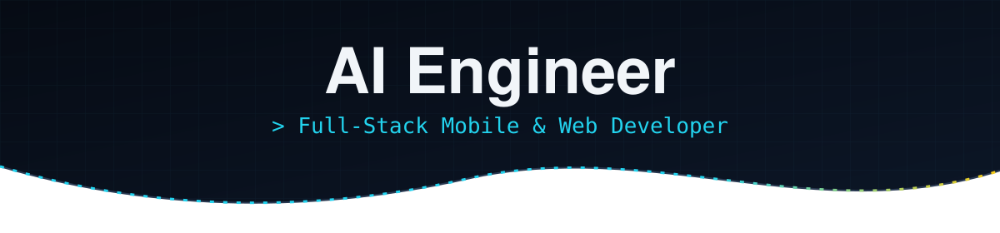
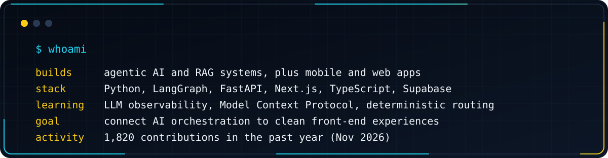
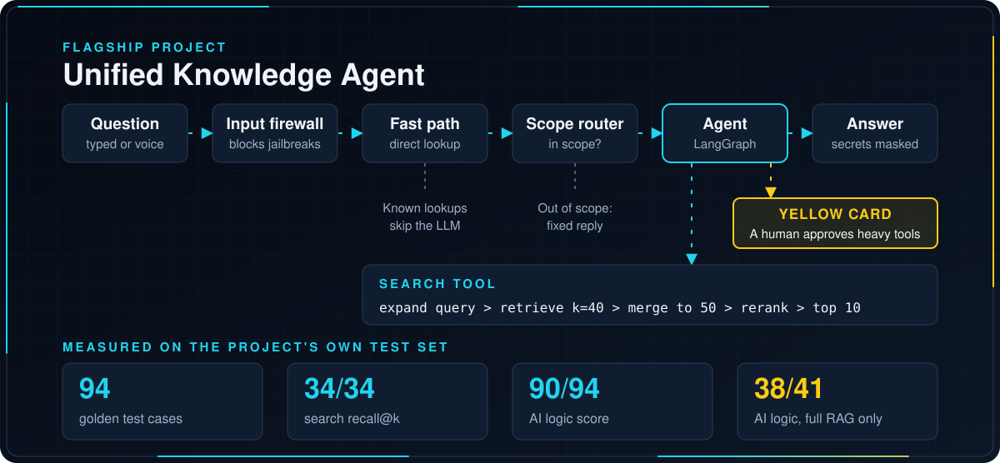
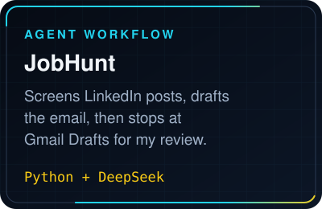
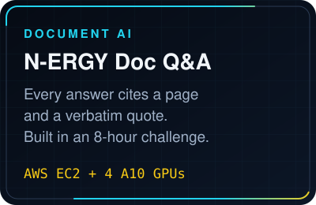
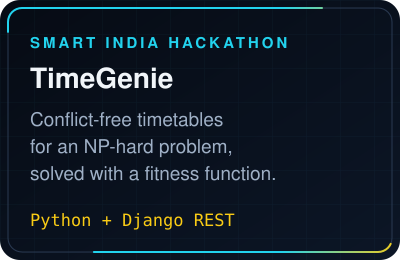
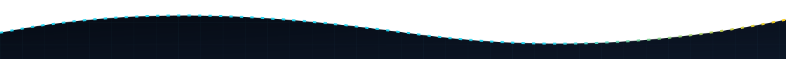

  

  
  
  

  

  

  
  
  

  <b>Mobile apps:</b>
  <a href="https://github.com/VictorLoucii/CaliWeather">CaliWeather</a> &middot;
  <a href="https://github.com/VictorLoucii/wealthra-finance-companion">Wealthra</a> &middot;
  <a href="https://github.com/VictorLoucii/ReactNativeCLIprojects">React Native projects</a>

<h3 align="center">Tech stack</h3>

<b>AI and LLM</b> 

<b>Languages</b> 

<b>Backend</b> 

<b>Mobile</b> 

<b>Web</b> 

<b>Data and cloud</b> 

<b>Data, vision and testing</b> 

<b>Tools</b> 

Open to collaborating on AI agents, mobile apps and web apps.

  

